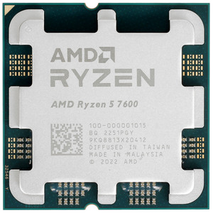
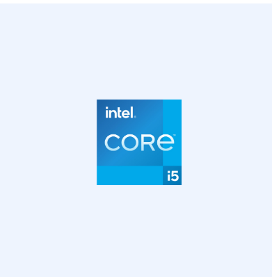
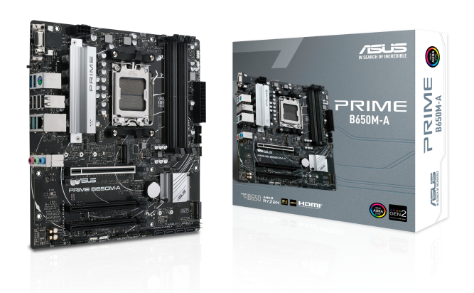
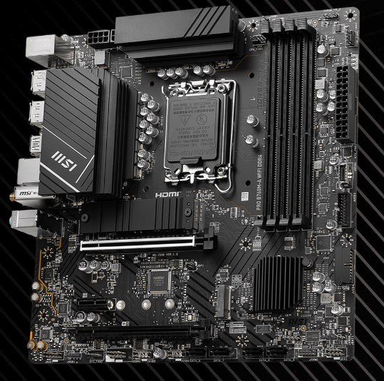
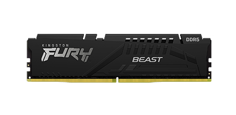
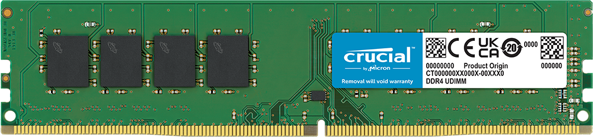
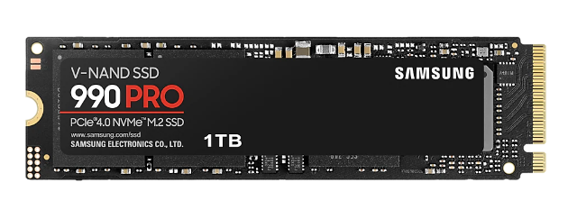
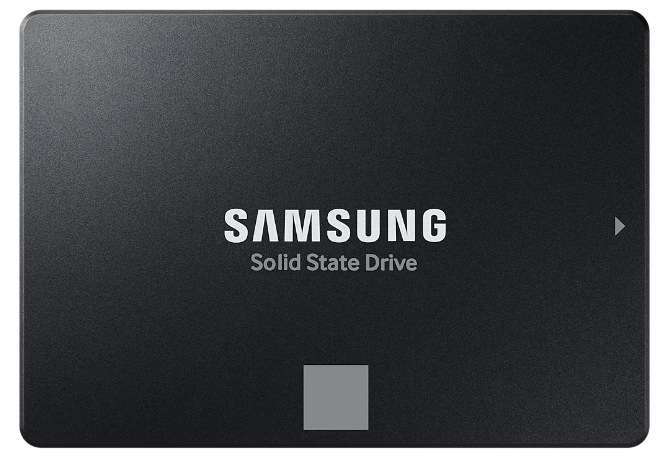
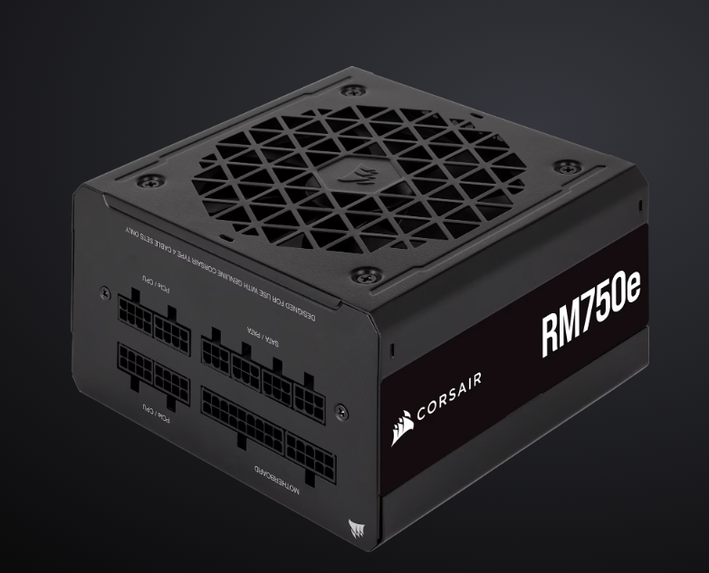
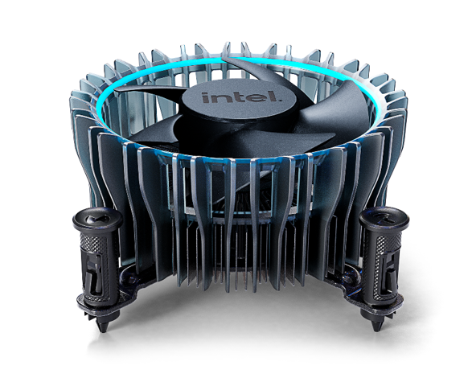

# Lab 3 — Teardown, and the same machine from the command line

Date: 08.11.26

## Part 1 — Ten parts
### AMD Ryzen 5 7600

**What it is:** Desktop processor, Zen 4 architecture, 6 cores / 12 threads, base clock 3.8 GHz, max boost up to 5.1 GHz, 32 MB L3 cache, default TDP 65 W. It also has built-in AMD Radeon graphics.

**Connects to:** Socket AM5, on boards with the A620, B650, B650E, B840, B850, X670, X670E, X870 or X870E chipsets. Its memory controller supports DDR5 (UDIMM, 2 channels, up to 128 GB) and it offers PCIe 5.0.

**Limit:** (1) DDR5 only: the memory controller is inside the processor and AMD lists "System Memory Type: DDR5", so DDR4 modules cannot be used with it. The different notch and voltage (1.2 V vs 1.1 V) also stop a DDR4 module from fitting a DDR5 slot. (2) Socket AM5 only: it does not fit boards with another socket, so it cannot go on an Intel board. (3) Memory speed: AMD lists up to DDR5-5200 with two modules, so faster modules such as DDR5-5600 are above the listed speed and need AMD EXPO overclocking to reach their rated speed. (4) Cooling: the boxed version ships with the AMD Wraith Stealth cooler (AMD's page: "Thermal Solution (PIB)"); the processor's default TDP is 65 W and its maximum operating temperature is 95 °C, so the cooler and the power supply have to handle at least that.

Source: https://www.amd.com/en/products/processors/desktops/ryzen/7000-series/amd-ryzen-5-7600.html

### Intel Core i5-13400

**What it is:** 13th Generation Intel Core i5 desktop processor (formerly Raptor Lake, Intel 7), 10 cores (6 performance + 4 efficient) and 16 threads. Performance cores: base 2.50 GHz, max turbo 4.60 GHz. Efficient cores: base 1.80 GHz, max turbo 3.30 GHz. 20 MB Intel Smart Cache, processor base power 65 W. Built-in Intel UHD Graphics 730.

**Connects to:** Socket FCLGA1700 (LGA1700). Two memory channels, up to 192 GB. Memory controller supports DDR5 (up to 4800 MT/s) or DDR4 (up to 3200 MT/s). PCI Express 5.0 and 4.0, up to 20 lanes.

**Limit:** (1) Memory: the processor accepts DDR5 or DDR4, but a motherboard has slots for only one of them, so the board decides. Speeds are capped at DDR5-4800 or DDR4-3200, so a DDR5-5600 module would run below its rated speed, while DDR4-3200 matches the limit exactly. (2) Socket: it needs LGA1700 and does not fit AM5 boards such as the ASUS PRIME B650M-A. (3) Cooling: the boxed version ships with the Intel Laminar RM1 cooler; the page's "PCG 2020C" is a thermal specification class, not a cooler.

Source: https://www.intel.com/content/www/us/en/products/sku/230495/intel-core-i513400-processor-20m-cache-up-to-4-60-ghz/specifications.html · Cooler: https://www.intel.com/content/www/us/en/support/articles/000095154.html

### ASUS PRIME B650M-A

**What it is:** Micro-ATX (mATX) motherboard, 24.4 cm x 24.4 cm, AMD B650 chipset, socket AM5. Supports AMD Ryzen 9000, 8000 and 7000 series desktop processors, up to 170 W CPUs.

**Connects to:** 4 DDR5 DIMM slots, dual channel (DDR5 5600(OC)/5400(OC)/5200/5000/4800, ECC and non-ECC unbuffered, AMD EXPO supported). Two M.2 slots (Key M, 2242/2260/2280): M.2_1 with PCIe 5.0 x4 on Ryzen 9000/7000, M.2_2 with PCIe 4.0 x4. Four SATA 6Gb/s ports (two SATA cables included). One PCIe 4.0 x16 slot for a graphics card. Power from the power supply through a 24-pin main connector and an 8-pin +12 V connector. Video outputs: DisplayPort, HDMI and VGA (they work through the CPU's built-in graphics).

**Limit:** (1) Socket: AM5 only, so it takes the Ryzen 5 7600 but not an Intel processor such as the i5-13400 (LGA1700). (2) Memory: DDR5 only. DDR4 modules do not fit, and the Crucial DDR4-3200 module cannot go on this board. (3) Memory speed: the board lists DDR5-5200 and below as supported and DDR5-5600 as overclocking (OC), the same ceiling as the Ryzen 7600, so the Kingston DDR5-5600 module reaches its rated speed only as an EXPO/OC profile. (4) Size: mATX, so it needs a case that accepts micro-ATX boards. (5) BIOS: ASUS's CPU Support list shows the Ryzen 5 7600 (6 cores, 3.8 GHz, 65 W) as validated since BIOS 0602, so a board that ships with an older BIOS version may need a BIOS update before it will start with this processor. The board has a BIOS FlashBack button, which allows the update from a USB stick without a working processor installed.

Source: https://www.asus.com/motherboards-components/motherboards/prime/prime-b650m-a/techspec/

### MSI PRO B760M-A WIFI DDR4

**What it is:** Micro-ATX (mATX) motherboard, 243.84 mm x 243.84 mm, Intel B760 chipset, socket LGA1700. Supports Intel Core 14th, 13th and 12th Gen processors, plus Pentium Gold and Celeron. Wi-Fi 6E and Bluetooth 5.3 are pre-installed.

**Connects to:** 4 DDR4 DIMM slots (dual channel, up to 128 GB, non-ECC unbuffered; 3200 MT/s is a JEDEC speed, faster speeds are overclocking; supports Intel XMP). Two M.2 slots (Key M, 2242/2260/2280): M.2_1 PCIe 4.0 x4 from the CPU, M.2_2 PCIe 4.0 x4 or SATA mode from the chipset. Four SATA 6G ports. One PCIe 4.0 x16 slot from the CPU for a graphics card. Power through the ATX power connector and two CPU power connectors. Video outputs: 2x HDMI and 2x DisplayPort (they work only with a processor that has built-in graphics).

**Limit:** (1) Socket: LGA1700 only, so it takes the Core i5-13400 but not an AMD processor such as the Ryzen 5 7600 (AM5). (2) Memory: DDR4 only. DDR5 modules do not fit, so the Kingston DDR5-5600 cannot go on this board, and the Crucial DDR4-3200 is the module for it. (3) Speed: 3200 MT/s is the board's top JEDEC speed and also the i5-13400's DDR4 limit, so the Crucial module runs at its rated speed without overclocking. (4) SATA/M.2 sharing: the page says SATA8 is unavailable when an M.2 SATA SSD is installed in M.2_2; that does not affect an NVMe drive. (5) Size: mATX, so it needs a case that accepts micro-ATX boards. (6) CPU support list: MSI's CPU Support list for this board includes the Core i5-13400 (both B0 and C0 steppings, 65 W, UHD Graphics 730), so it is a supported processor. The list shows no minimum BIOS version, so I could not tell whether a BIOS update is needed for it.

Source: https://www.msi.com/Motherboard/PRO-B760M-A-WIFI-DDR4/Specification

### Kingston FURY Beast DDR5-5600 16 GB

**What it is:** Desktop DDR5 memory module (DIMM), 16 GB single module (1x16GB), 5600 MT/s, CAS latency CL36 (timings 36-38-38) at 1.25 V, AMD EXPO / Intel XMP version. Part number KF556C36BBE-16. Dimensions 133.35 mm x 34.9 mm x 6.62 mm, operating temperature 0 °C to 85 °C.

**Connects to:** The DDR5 DIMM slots of a motherboard, one module per slot, two channels on both boards. On your boards that means the 4 DDR5 slots of the ASUS PRIME B650M-A. It works with AMD (EXPO profile) and Intel DDR5 platforms (XMP profile).

**Limit:** (1) DDR5 only: it cannot be used in DDR4 boards, so it does not fit the MSI PRO B760M-A WIFI DDR4. (2) Speed: the Ryzen 5 7600 lists up to DDR5-5200 for two modules, and the ASUS board lists 5600 as overclocking (OC). So 5600 MT/s is reached only by enabling its EXPO profile, otherwise it runs at a lower default speed. (3) Capacity: one 16 GB module fills one slot and runs in single channel; a second identical module would be needed to use dual channel.

Source: https://www.kingston.com/en/memory/gaming/kingston-fury-beast-ddr5-memory?speed=5600mt%2Fs&total%20(kit)%20capacity=16gb&kit=single%20module&cas%20latency=36&dram%20density=16gbit&profile%20type=amd%20expo%20%2F%20intel%20xmp&color=black

### Crucial DDR4-3200 16 GB

**What it is:** Desktop DDR4 memory module, UDIMM (unbuffered), 16 GB single module, DDR4-3200, CAS latency 22 (default JEDEC timings 22-22-22), 1.2 V, die density 8Gb or 16Gb. Part number: CT16G4DFRA32A.

**Connects to:** The DDR4 DIMM slots of a desktop motherboard, one module per slot. On your boards that means the 4 DDR4 slots of the MSI PRO B760M-A WIFI DDR4.

**Limit:** (1) DDR4 only: it does not fit DDR5 boards, so it cannot go on the ASUS PRIME B650M-A, and the Ryzen 5 7600 cannot use it at all because its memory controller supports only DDR5. (2) Speed: 3200 MT/s is the board's top JEDEC speed and the i5-13400's DDR4 maximum, so the module runs at its rated speed without overclocking. (3) A single module uses one memory channel; a second identical module would be needed for dual channel.

Source: https://www.crucial.com/memory/ddr4/ct16g4dfra32a

### Samsung 990 PRO 1 TB

**What it is:** NVMe solid-state drive, 1,000 GB (1 TB), M.2 2280 form factor (80 x 22 x 2.3 mm, max 9.0 g), PCIe Gen 4.0 x4 interface with NVMe 2.0. Sequential read up to 7,450 MB/s and write up to 6,900 MB/s (random read up to 1,200,000 IOPS, write up to 1,550,000 IOPS). Samsung V-NAND, Samsung controller, 1 GB LPDDR4 cache, AES 256-bit encryption, 5-year or 600 TBW warranty. Average power 5.4 W, maximum 7.8 W.

**Connects to:** An M.2 slot (Key M, 2280) on the motherboard. It needs no SATA data cable and no separate power cable, because the slot carries both. Both of your boards have two M.2 slots that accept 2280 drives: the ASUS PRIME B650M-A (M.2_1 PCIe 5.0 x4 with the Ryzen 7600, M.2_2 PCIe 4.0 x4) and the MSI PRO B760M-A WIFI DDR4 (both slots PCIe 4.0 x4).

**Limit:** (1) Interface: it is a PCIe Gen 4 drive, so in the ASUS PCIe 5.0 slot it still runs at Gen 4 speed, and it cannot be plugged into a SATA port or a 2.5" bay at all. (2) The quoted speeds are the maximum ("up to") and depend on the system; the slot must supply PCIe 4.0 x4 to reach them. (3) Endurance: the warranty ends at 5 years or 600 TBW, whichever comes first.

Source: https://www.samsung.com/uk/memory-storage/nvme-ssd/990-pro-1tb-nvme-pcie-gen-4-mz-v9p1t0bw/

### Samsung 870 EVO 1 TB

**What it is:** SATA solid-state drive, 1,000 GB (1 TB), 2.5-inch form factor (3.94 x 2.75 x 0.27 in, about 0.10 lb), SATA 6 Gb/s interface (compatible with SATA 3 Gb/s and 1.5 Gb/s). Sequential read up to 560 MB/s and write up to 530 MB/s (random read up to 98,000 IOPS, write up to 88,000 IOPS, measured with Intelligent TurboWrite active). Samsung V-NAND 3-bit MLC, Samsung MKX controller, 1 GB LPDDR4 cache, AES 256-bit encryption. Average power 2.5 W, maximum 4.0 W.

**Connects to:** A SATA 6 Gb/s port on the motherboard through a SATA data cable, plus a separate SATA power cable from the power supply. It sits in a 2.5-inch drive bay of the case. Both of your boards have 4 SATA 6Gb/s ports (the ASUS PRIME B650M-A includes two SATA cables in the box).

**Limit:** (1) Interface speed: the SATA 6 Gb/s bus caps it at about 550 MB/s, which is why the drive's top speed is 560 MB/s, roughly 13 times slower than the 990 PRO's 7,450 MB/s. (2) Form factor: it is a 2.5-inch drive, so it cannot go into an M.2 slot; it needs a SATA port, a data cable, a power cable and a drive bay in the case. (3) The Samsung page lists the installation kit as not available, so the cable and the mounting come from the motherboard box, the power supply and the case, not from the drive.

Source: https://www.samsung.com/us/memory-storage/sata-ssd/870-evo-sata-2-5-ssd-1tb-sku-mz-77e1t0b-am/

### Corsair RM750e (750 W)

**What it is:** Fully modular ATX power supply, 750 W continuous power, 80 PLUS Gold efficiency, Type 4 cables, Zero RPM fan mode, Modern Standby support. Size 140 x 150 x 86, weight 2 kg, 7-year warranty, MTBF 100,000 hours. Listed ATX12V version: 2.53.

**Connects to:** The motherboard through the modular 24-pin ATX cable (1 cable, 610 mm, sleeved) and the CPU power through the EPS/ATX12V 8-pin (4+4) cable (the table lists 2 connectors in total, 650 mm, flat). Graphics cards through a modular PCIe 8-pin (6+2) cable (600 mm, flat). Drives through 7 SATA power connectors (for example the 2.5-inch Samsung 870 EVO) and 4 PATA (Molex) connectors. It mounts in the PC case's power supply bay.

**Limit:** (1) Total power: 750 W continuous is the ceiling for everything it feeds. (2) One supply powers one computer: its single 24-pin connector can only plug into one motherboard, so the second build needs its own power supply. (3) Cables: it is fully modular, so only the cables that are plugged in are available, and the connector counts above are all there is (7 SATA, 4 PATA). (4) Motherboard needs: the ASUS board needs the 24-pin and one 8-pin +12 V connector, and the MSI board lists two CPU power connectors. The supply has one 24-pin and two 8-pin (4+4) CPU connectors, so it can power either board's CPU side, but its single 24-pin cable means it can only feed one of the two builds. Neither build needs the PCIe graphics cable, because both processors have built-in graphics.

Source: https://www.corsair.com/ww/en/p/psu/cp-9020248-ww/rme-series-rm750e-fully-modular-low-noise-atx-power-supply-cp-9020248-ww#tab-support

### Intel Laminar RM1 cooler (stock cooler, ships with the Core i5-13400)

**What it is:** Air cooler for Intel desktop processors, with an aluminium-fin heatsink and a copper base, a standard-size cooler with an Intel-validated 3.9 BA fan. Size up to 100 x 100 mm, height up to 47 mm (top of fan to bottom of heatsink), mass up to 350 g. Three-year limited warranty. It is not sold separately to end users: it only comes in the box of listed Intel boxed processors, including the i5-13400.

**Connects to:** The processor's socket on the motherboard. It is shipped with 12th, 13th and 14th Gen Intel Core boxed processors, which use socket LGA1700, so it fits the MSI PRO B760M-A WIFI DDR4 together with the i5-13400. It plugs into the board's CPU fan header (the MSI page lists a CPU fan header).

**Limit:** (1) It is made for the Intel processors named on Intel's page, not for AMD's AM5 socket, so it does not go with the Ryzen 5 7600 or the ASUS board. (2) Cooling capacity: not stated on the page. The i5-13400 is a 65 W processor. (3) Height: 47 mm at most, so the case's cooler clearance must be at least that. (4) It is not sold separately, so replacing it means buying a different cooler.

Source: https://www.intel.com/content/www/us/en/support/articles/000089190/graphics.html · Box contents: https://www.intel.com/content/www/us/en/support/articles/000095154.html

## Motherboards

| | ASUS PRIME B650M-A | MSI PRO B760M-A WIFI DDR4 |
|---|---|---|
| Socket | AM5 | LGA1700 |
| Chipset | AMD B650 | Intel B760 |
| Memory type / slots | DDR5, 4 DIMM slots, dual channel | DDR4, 4 DIMM slots, dual channel |
| M.2 slots | 2 (M.2_1 PCIe 5.0 x4 with Ryzen 9000/7000, M.2_2 PCIe 4.0 x4) | 2 (both PCIe 4.0 x4; M.2_2 also supports SATA mode) |
| SATA ports | 4 | 4 |
| CPU generations accepted | Ryzen 7000, 8000 and 9000 series | Intel 12th, 13th and 14th Gen |
| BIOS update needed? | Ryzen 5 7600 is validated since BIOS 0602; older BIOS may need an update | Not listed: MSI's CPU Support list shows the i5-13400 (B0 and C0) with no minimum BIOS version |

## Two builds
### Build 1 — AMD

| Part | Model | Why it fits here |
|---|---|---|
| Processor | AMD Ryzen 5 7600 | Socket AM5, 65 W, built-in Radeon graphics, so no graphics card is needed |
| Motherboard | ASUS PRIME B650M-A | Socket AM5 and the B650 chipset match the processor; the CPU Support list shows the 7600 validated since BIOS 0602 |
| Memory | Kingston FURY Beast DDR5-5600, 16 GB | The processor and the board take DDR5 only; the module is DDR5 and runs at 5600 MT/s through its EXPO profile |
| SSD | Samsung 870 EVO 1 TB | The ASUS box includes two SATA cables, and the Corsair supply (below) has 7 SATA power connectors, so the drive's data and power cables are covered |
| Power supply | Corsair RM750e (750 W) | 24-pin and 8-pin CPU connectors for the ASUS board, 7 SATA power connectors for the drive; 750 W is far above what a 65 W processor needs |
| Cooler | AMD Wraith Stealth (in the processor's box, not one of the ten parts) | Boxed Ryzen 7600 ships with it, so the build doesn't need a separate cooler |

**What this build still needs:** a case that takes a micro-ATX board and has a 2.5-inch drive bay, a monitor and cables, keyboard and mouse, and an operating system. A second memory module would be needed for dual channel.

### Build 2 — Intel

| Part | Model | Why it fits here |
|---|---|---|
| Processor | Intel Core i5-13400 | Socket LGA1700, 65 W, built-in UHD Graphics 730, so no graphics card is needed |
| Motherboard | MSI PRO B760M-A WIFI DDR4 | Socket LGA1700 and the B760 chipset match; the CPU Support list includes the i5-13400 |
| Memory | Crucial DDR4-3200 16 GB | The board has DDR4 slots only, and 3200 MT/s is both the board's top JEDEC speed and the i5-13400's DDR4 limit |
| SSD | Samsung 990 PRO 1 TB | M.2 2280 NVMe fits the board's M.2_1 slot (PCIe 4.0 x4 from the CPU), so it runs at its full Gen 4 speed; it needs no SATA cable and no power cable |
| Cooler | Intel Laminar RM1 | Ships in the i5-13400's box, fits LGA1700 |
| Power supply | none in the list | See below |

**What this build still needs:** a **power supply**, because the list has only one and its single 24-pin cable can power only one computer. Also a case that takes a micro-ATX board and has room for the 47 mm cooler, a monitor and cables, keyboard and mouse, and an operating system.

**Choices I made (assumptions):**
- The power supply goes to the AMD build because the only drive that needs SATA power (the 870 EVO) is in that build, and the ASUS box already includes SATA cables.
- The 990 PRO goes in the Intel build, since it runs at the same Gen 4 speed on either board; the ASUS board's PCIe 5.0 slot gives it no advantage.
- The Laminar RM1 is the "stock cooler" from the list; the Ryzen's own box also contains a cooler.

## Part 2 — Same facts, two operating systems

| Fact | Windows 11 (PowerShell, on the host) | Linux (Ubuntu VM) |
|---|---|---|
| CPU model | `Get-CimInstance Win32_Processor` → Name: 12th Gen Intel(R) Core(TM) i7-12700H | `lscpu` → Model name: 12th Gen Intel(R) Core(TM) i7-12700H |
| Cores / threads | `Get-CimInstance Win32_Processor` → NumberOfCores 14, NumberOfLogicalProcessors 20 (max clock 2300 MHz) | `lscpu` → CPU(s): 4, Core(s) per socket: 4, Thread(s) per core: 1 |
| Total memory | `Get-CimInstance Win32_PhysicalMemory` → Capacity 8589934592 bytes per module (8 GiB) x 2 = 16 GiB | `free -h` → Mem total 3.3Gi |
| Memory modules and speed | `Get-CimInstance Win32_PhysicalMemory` → 2 modules (Controller0-ChannelA-DIMM0 and Controller1-ChannelA-DIMM0), Speed 3200, ConfiguredClockSpeed 3200, SMBIOSMemoryType 26 (DDR4), FormFactor 12 (SODIMM) | `sudo dmidecode -t memory` → only "SMBIOS 2.5 present." and no memory device listed |
| Disk model and type | `Get-PhysicalDisk` → NVMe WD PC SN560 SDDPNQE-1T00-1002, MediaType SSD, BusType RAID, Size 1024209543168 bytes | `lsblk -d -o NAME,MODEL,ROTA,TRAN,SIZE` → sda, VBOX HARDDISK, ROTA 1, sata, 25G |
| Free space | `Get-Volume C` → SizeRemaining 76.71 GB of Size 953.17 GB | `df -h /` → 20G available of 25G (15% used) |
| Architecture | `$env:PROCESSOR_ARCHITECTURE` → AMD64 | `uname -m` → x86_64 |

**How the names differ:** the two systems print the same facts under different names: Windows calls the architecture `AMD64` and Linux calls it `x86_64`, and Windows lists cores as `NumberOfCores` and `NumberOfLogicalProcessors` while Linux shows `Core(s) per socket` and `Thread(s) per core`. Windows gives sizes in bytes or GB through objects and tables, Linux prints text tables with units like `3.3Gi` and `25G`.

**What the VM showed differently from the host:** the CPU model is passed through unchanged, but the VM reports only the 4 cores I assigned with 1 thread each, instead of the host's 14 cores and 20 threads. It shows 3.3 GiB of memory instead of the host's 16 GiB, no memory modules at all (`dmidecode` finds none, while Windows sees two 8 GiB DDR4-3200 modules), and a virtual 25 GB `VBOX HARDDISK` on a SATA bus instead of the real 1 TB NVMe SSD. The hypervisor passes through the processor's identity and hides or replaces the physical memory and the storage.

## What did not work the first time

**1. The wrong Crucial module.**
Saw: the first specification page I copied said "Module Type: SODIMM".
It turned out to be: a SO-DIMM is the short laptop memory, but the lab lists a Crucial DDR4-3200 16 GB **DIMM**, and the MSI board has desktop DIMM slots, so that module would not have fitted.
I did: opened the desktop version of the module on crucial.com, where the specs say UDIMM, and used its specs for the caption. Along the way crucial.com also blocked me for a while with "Error 429 - Too Many Requests" (too many page loads in a short time), and I worked on the other parts and retried later.

**2. A build that would not work.**
Saw: in my first draft of the AMD build I had put the Crucial DDR4-3200 module next to the Ryzen 5 7600 and the ASUS PRIME B650M-A.
It turned out to be: wrong. The Ryzen 5 7600's memory controller supports only DDR5, and the ASUS board has only DDR5 slots, while the Crucial module is DDR4.
I did: moved the Kingston FURY Beast DDR5-5600 into the AMD build and the Crucial DDR4 into the Intel build, where the MSI board takes DDR4 only.

**3. The cooler that was not a cooler.**
Saw: Intel's specification page for the i5-13400 has a line "Thermal Solution Specification: PCG 2020C", and I took it for the cooler.
It turned out to be: a thermal specification class (a design guideline for coolers), not a product. The spec page names no cooler at all.
I did: found Intel's support page on what is in the boxed processor, which lists the Intel Laminar RM1 cooler for the i5-13400, and used that as my source for the cooler.

**4. No SSH into the Ubuntu VM.**
Saw: `ssh -p 2222 damir@127.0.0.1` first said "Connection refused", later "Connection reset", and inside Ubuntu `systemctl status ssh` said "Unit ssh.service could not be found".
It turned out to be: first the VirtualBox port-forward rule was not active yet (the NAT Network only picks it up after the VMs restart), and then the SSH server was not installed in Ubuntu at all.
I did: restarted the VMs after adding the rule, ran `sudo apt install openssh-server`, then `sudo systemctl enable --now ssh`, and checked `systemctl status ssh.socket` until it said `active (running)` and listening on port 22. After that I could copy the output out of the VM as text, instead of retyping a screenshot.

 ## Evidence
   - [evidence/windows-specs.txt](evidence/windows-specs.txt): raw PowerShell output from the host with the real CPU, both memory modules, the disk and free space
   - [evidence/linux-specs.txt](evidence/linux-specs.txt): raw output from the Ubuntu VM for the same facts; it describes the virtual machine, not the laptop
   - evidence/photos/: the makers' product pages (photos or screenshots) for the ten parts