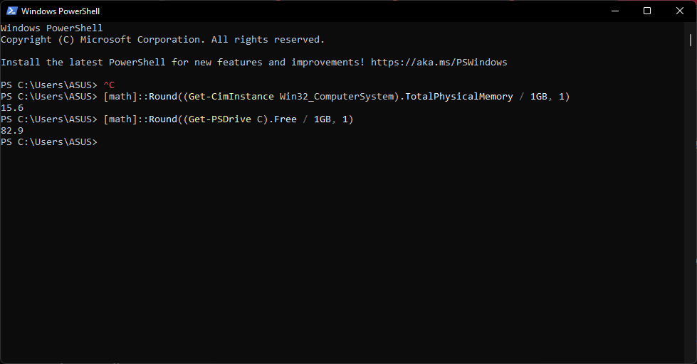
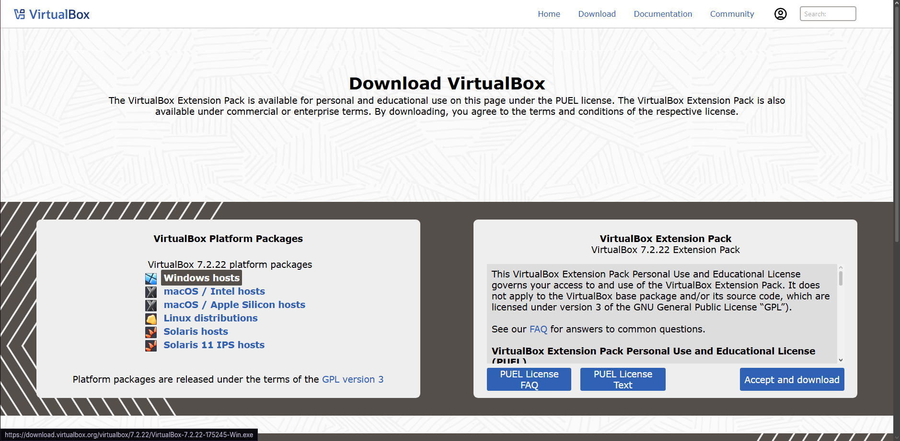
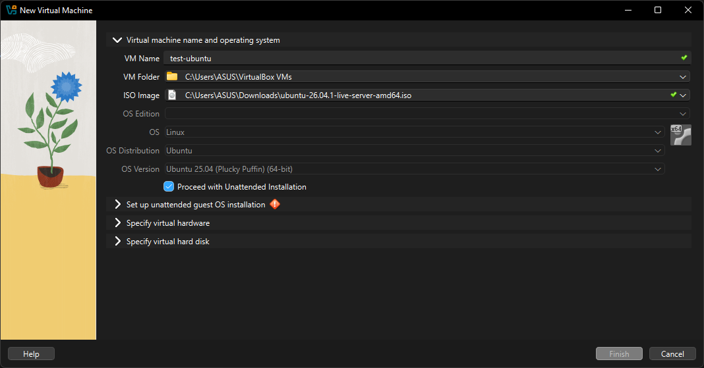
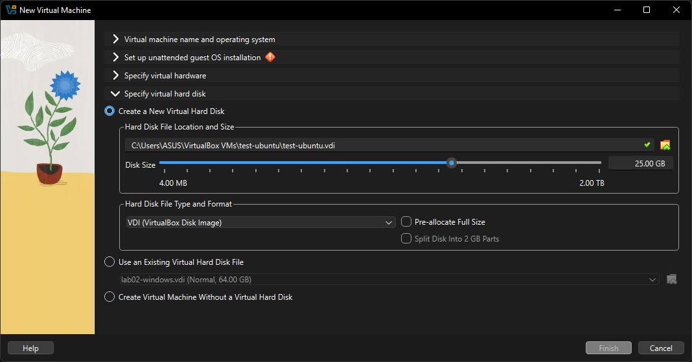
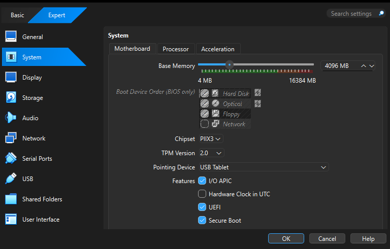
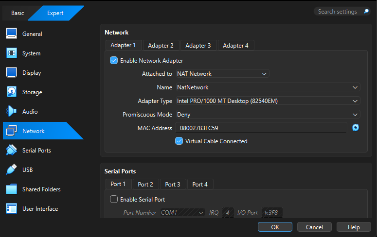
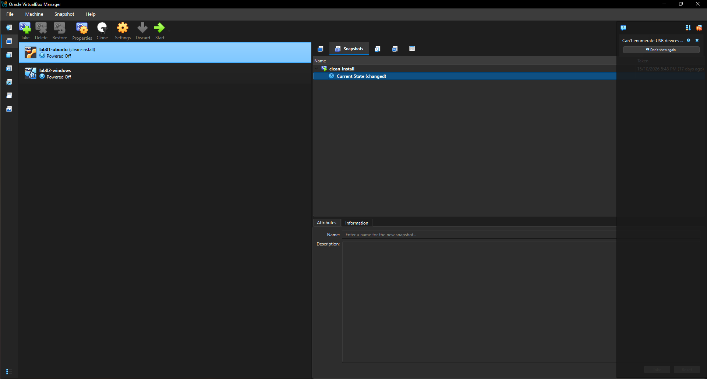

# How to build a test machine (Ubuntu Server + Windows 11) on a laptop

For: Aigerim. You need a laptop, an internet connection and about two hours.
Nothing here costs money. If any screen asks you to pay or to enter a product key, stop and read the "If something goes wrong" section at the end.


## Part 0. Check that the laptop is suitable

**Step 1. Check memory and free disk space.**
Click Windows button, type `PowerShell` and press Enter. A blue window opens. Type each command below and press Enter.

Total memory, in GB:
```
[math]::Round((Get-CimInstance Win32_ComputerSystem).TotalPhysicalMemory / 1GB, 1)
```
Free disk space on drive C, in GB:
```
[math]::Round((Get-PSDrive C).Free / 1GB, 1)
```

Why: two virtual machines run at the same time, and each one takes a share of the laptop's memory and disk. You need at least **16 GB of memory** and **100 GB of free disk space**. With 8 GB the laptop will become very slow. Drive C is where VirtualBox stores the machines by default.

> Check: the first number is 16 or more, and the second is 100 or more. If a number is lower, do not continue: use another laptop or free up space first.

**Step 2. Check the processor type.**
In the same window run:
```
$env:PROCESSOR_ARCHITECTURE
```
Why: the Windows evaluation image only exists for Intel/AMD processors (x64). On an Apple Silicon Mac (M1, M2, M3, M4) this guide does not work for Windows; use another laptop.

> Check: the answer is `AMD64`. This name is used for both Intel and AMD processors.

## Part 1. Install the virtualisation program (VirtualBox)

**Step 3. Download VirtualBox 7 from https://www.virtualbox.org/wiki/Downloads.

Why VirtualBox: it is free for office use and works the same way on Windows, Mac and Linux. Do **not** download the "Extension Pack": it is under a different licence that is not free for company use, and this guide does not need it.

**Step 4. Run the installer and keep all default options. Restart if it asks.**
Why: the defaults are correct; changing them only creates problems.

> Check: VirtualBox Manager opens and shows an empty machine list.

## Part 2. Download the two operating systems

**Step 5. Ubuntu Server.** Download the `<Ubuntu Server version, e.g. 24.04 LTS>` ISO from https://ubuntu.com/download/server. Save it in Downloads.
Why Ubuntu Server LTS: it is free, and LTS means it gets security updates for five years, so the machine stays safe without upgrades.

**Step 6. Windows 11 Enterprise evaluation.** Go to https://www.microsoft.com/en-us/evalcenter/download-windows-11-enterprise, fill in the short form and download **Enterprise, 64-bit, English (United States)**. Save it in Downloads.
Why the evaluation: it is free and legal for **90 days** and needs no product key. Never type a key you found online, and never download a "pre-activated" Windows from anywhere: that is pirated software.
After 90 days the evaluation runs out. See "After 90 days" at the end.

> Check: you have two `.iso` files in Downloads. Do not put them in a project or Git folder.

## Part 3. Create the Ubuntu machine

**Step 7. In VirtualBox click Machine → New.** Name: `test-ubuntu`. ISO Image: the Ubuntu ISO. Tick **Proceed with Unattended Installation**.


**Step 8. Set Base Memory to 4096 MB and Processors to 4.**
Why: Ubuntu Server has no desktop, so it needs little. Keep processors at no more than half the laptop's cores so the laptop stays usable.

**Step 9. Create a virtual hard disk of 25 GB. Leave "Pre-allocate Full Size" **unticked**.**

Why: unticked means the disk file starts small and grows only as needed (a "thin" disk). A ticked box would take all 25 GB from the laptop immediately.

**Step 10. Click Finish.**

## Part 4. Install Ubuntu

**Step 11. Start the machine.** The installer starts by itself. Choose your language and keyboard.

**Step 12. Choose "Ubuntu Server" (not "minimized"), keep the default network and storage options, and when asked, tick "Install OpenSSH server".**
Why: SSH lets you copy text out of the machine from the laptop, which a plain console window does not allow.

**Step 13. Create the account.** Write the name and the password **on paper**, not in a file that goes to Git.

**Step 14. When the installer asks to reboot, click Reboot Now. If it says to remove the installation medium, press Enter.**

> Check: log in, then run `uname -a` and `lsb_release -a`. You should see the Ubuntu version you downloaded.

## Part 5. Create the Windows machine

**Step 15. Machine → New.** Name: `test-windows`. ISO Image: the Windows ISO. Type: Microsoft Windows, Version: Windows 11 (64-bit). Tick **Proceed with Unattended Installation**.

**Step 16. Memory 4096 MB, Processors 5.**
Why: 4 GB is the minimum for Windows 11. On a 16 GB laptop, 4 GB (Windows) + 4 GB (Ubuntu) leaves about 8 GB for the laptop itself.

**Step 17. Disk 64 GB, Pre-allocate Full Size unticked.**
Why: 64 GB is the Windows 11 minimum; thin so it only takes what it uses.

**Step 18. Before you start it: Settings → System.** Check that **Enable EFI**, **TPM Version v2.0** and **Enable Secure Boot** are ticked.


## Part 6. Install Windows (30–40 minutes)

**Step 19. Start the machine. When you see "Press any key to boot from CD or DVD", click inside the window and press a key quickly.** If you miss it, restart the machine and try again. Do not press a key again after the first restart.

**Step 20. Language → Install now → "I don't have a product key" → choose Windows 11 Enterprise (Evaluation).**
Why: no key is needed for the evaluation.

**Step 21. Accept the licence, choose Custom: Install Windows only, select Drive 0 Unallocated Space, click Next.** The machine restarts several times.

**Step 22. At the sign-in screen choose Sign-in options → Domain join instead,** then create a local account with a password. Write the password on paper.
Why: this avoids having to use a personal Microsoft account. If that option is missing, use any free Microsoft account.

**Step 23. Switch all privacy options off.**

**Step 24. Install Guest Additions.** In the Windows machine's menu: Devices → Insert Guest Additions CD image. Open File Explorer → the DVD drive → run `VBoxWindowsAdditions.exe` → defaults → restart.
Why: after this, the screen fits the window and you can copy and paste between the laptop and the machine.

> Check: the Windows desktop fills the window.

## Part 7. Put both machines on one network

**Step 25. Create a NAT Network.** In VirtualBox Manager: File → Tools → Network Manager → NAT Networks → Create. Keep the name `NatNetwork`, the range `10.0.2.0/24`, and make sure **Enable DHCP** is ticked.

**Step 26. For each machine: Settings → Network → Adapter 1 → Attached to: NAT Network, Name: NatNetwork.** Do this with the machine switched off.



Why NAT Network and not the other choices:
- **NAT** gives each machine its own private router, so the two machines cannot see each other.
- **Bridged** gives each machine its own address on the office network. Many networks (including the Innotech campus Wi-Fi) drop addresses they do not know, so the machine may get no connection at all.
- **Host-only** lets the machines see each other but has no internet.
NAT Network is the only one that gives both: the two machines see each other and reach the internet.

**Step 27. Start both machines and find their addresses.**
- Ubuntu: `ip -br a` → the address on `enp0s3`, for example `10.0.2.5`.
- Windows: open PowerShell and run `ipconfig` → "IPv4 Address", for example `10.0.2.50`.

> Check: both addresses start with `10.0.2.`

**Step 28. Allow ping on Windows (one rule, firewall stays on).** Open PowerShell **as Administrator** and run:
```
New-NetFirewallRule -DisplayName "Allow ping in (ICMPv4)" -Protocol ICMPv4 -IcmpType 8 -Direction Inbound -Action Allow -Profile Any
```
Why: Windows blocks incoming ping by default. Do **not** switch the firewall off: this single rule only allows ping.

**Step 29. Test.**
- On Ubuntu: `ping -c 4 <Windows address>` and `ping -c 4 ubuntu.com`
- On Windows: `ping <Ubuntu address>` and `ping ubuntu.com`
**Note:** replace `<Ubuntu address>` and `<Windows address>` in the commands below with the addresses you found in Step 27 (for example `10.0.2.5` and `10.0.2.50`). Your numbers may be different.

> Check: every test shows "0% packet loss" (or "0% loss").

## Part 8. Take a clean snapshot

**Step 30. Shut both machines down properly** (Ubuntu: `sudo poweroff`; Windows: Start → Shut down).
Why: a snapshot taken while the machine is off is smaller and cannot catch it in a half-written state.

**Step 31. In VirtualBox Manager select a machine → Snapshots (top right) → Take.** Name it `clean-install`. Do this for **both** machines.

Why: this is the answer to "without breaking anything". The developer can break the machine as much as he likes; going back to the snapshot takes seconds.

**Step 32. How to go back.** Shut the machine down → Snapshots → right-click `clean-install` → **Restore**. Untick "Create a snapshot of the current machine state" only if you do not need what he did.
> Check: after restoring, the machine looks exactly like it did right after installation.

## If something goes wrong

| What you see | What it means | What to do |
|---|---|---|
| "This PC can't run Windows 11" | The machine has no TPM or Secure Boot | Step 18: tick EFI, TPM v2.0, Secure Boot. Restart the installation. |
| "Press any key to boot from CD" missed | You were too slow | Restart the machine and press a key at once. |
| Windows shows only an `fe80::` address or `169.254.x.x` and no `10.0.2.x` address | Windows is not getting an address from the network (it did not get an answer from DHCP) | 1) Settings → Network: cable connected ticked and NAT Network chosen. 2) Shut down fully and start again. 3) If it still fails, set a fixed address in PowerShell as Administrator: `New-NetIPAddress -InterfaceAlias "Ethernet" -IPAddress 10.0.2.50 -PrefixLength 24 -DefaultGateway 10.0.2.1` |
| `ping 8.8.8.8` works but `ping ubuntu.com` says "could not find host" | No DNS server | `Set-DnsClientServerAddress -InterfaceAlias "Ethernet" -ServerAddresses 8.8.8.8,1.1.1.1` |
| Ubuntu → Windows ping times out but Windows → Ubuntu works | Windows firewall blocks incoming ping | Step 28 |
| The laptop becomes very slow with both machines running | Too much memory promised | Shut one machine down and lower the memory (Settings → System), never above half the laptop's RAM in total |

## After 90 days

The Windows evaluation runs out after 90 days. You have two choices, and the office has to decide which:
1. Buy a Windows licence and activate this machine.
2. Delete the Windows machine and follow Parts 5–8 again with a fresh evaluation ISO.
Ubuntu does not expire.
